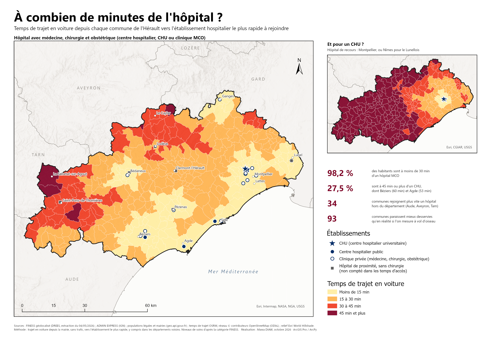
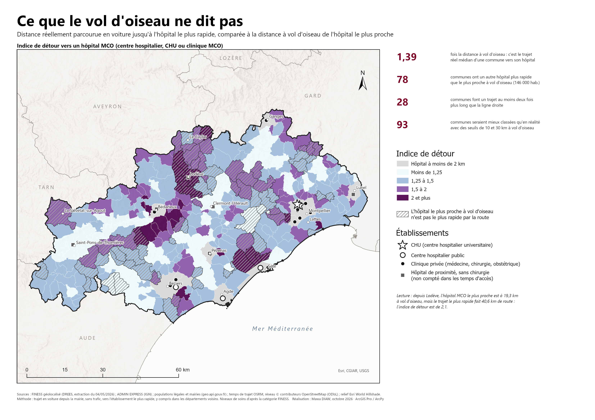

# Accessibilité des communes de l'Hérault aux hôpitaux

Combien de temps faut-il, en voiture, pour rejoindre un hôpital depuis chacune des 341 communes de l'Hérault ? Ce projet ArcPy reprend un contrôle du Master 2 G2M (Paris 8) réalisé sur la Lozère, et l'améliore : les données sont officielles, l'accès est mesuré en **temps de trajet par la route** plutôt qu'à vol d'oiseau, on distingue **trois niveaux de soins** et on compte la **population concernée**.



## Résultats clés

Population de l'Hérault prise en compte : 1 230 289 habitants (populations légales, geo.api.gouv.fr).

| Niveau de soins | < 15 min | 15-30 min | 30-45 min | ≥ 45 min | Temps moyen pondéré par la population |
|---|---|---|---|---|---|
| Hôpital MCO (CH, CHU, clinique MCO) | 74,9 % | 23,3 % | 1,7 % | 0,1 % | 10,7 min |
| CHU (recours) | 33,1 % | 22,0 % | 17,5 % | 27,5 % | 33,0 min |

- **98,2 % des habitants sont à moins de 30 minutes d'un hôpital MCO.** Les 1,8 % restants vivent dans 62 communes, dans les Hauts cantons (Espinouse, Somail, Minervois), sur le Larzac et dans les garrigues du nord-est (Claret, Vacquières). Les plus éloignées sont Romiguières (66 min), La Salvetat-sur-Agout (54 min), Le Soulié (51 min) et Sorbs (50 min).
- **Le CHU de Montpellier est très inégalement accessible** : 184 communes et 338 000 habitants, sont à 45 minutes ou plus. C'est le cas de Béziers (60 min), d'Agde (53 min) et de Pézenas (47 min), pourtant bien équipées en hôpitaux MCO. À l'est, pour 13 communes du Lunellois, le CHU le plus rapide est celui de Nîmes.
- **Pour 34 communes, l'hôpital MCO le plus rapide se trouve hors de l'Hérault** (Lézignan-Corbières, Narbonne, Millau, Mazamet). Une analyse limitée au département aurait surestimé leurs temps d'accès.
- **Le vol d'oiseau trompe** : pour 78 communes, l'établissement le plus proche à vol d'oiseau n'est pas le plus rapide par la route. Si on applique les seuils de l'ancien contrôle (10 et 30 km), 93 communes sont classées « mieux » qu'elles ne le sont réellement. En médiane, le trajet réel vers l'hôpital le plus rapide est 1,39 fois plus long que la distance à vol d'oiseau de l'hôpital le plus proche, et il fait plus du double pour 28 communes.



## Méthode

1. **Communes** : contours ADMIN EXPRESS (IGN) des 341 communes de l'Hérault. La population et la position de la **mairie** viennent de l'API Découpage administratif. On part de la mairie plutôt que du centroïde, qui tombe parfois en pleine forêt ou en pleine garrigue.
2. **Établissements** : fichier FINESS géolocalisé (DREES, extraction du 04/05/2026). Il couvre l'Hérault et les départements voisins (Aude, Aveyron, Gard, Tarn) pour éviter l'effet de bord. On ne garde que les sites qui hospitalisent ; les hôpitaux de jour psychiatriques, les CMP, les antennes SMUR, les centres de dépistage et les structures de SSR sont écartés. Il reste 50 établissements, répartis en trois niveaux :
   - `CHU` : sites du CHU de Montpellier (Lapeyronie, Gui de Chauliac, Saint-Éloi, Arnaud de Villeneuve) et CHU de Nîmes ;
   - `MCO` : centres hospitaliers et cliniques de médecine-chirurgie-obstétrique (FINESS 355, 365, 128) ;
   - `PROX` : hôpitaux de proximité (FINESS 106).
3. **Temps de trajet** : matrice OSRM (réseau OpenStreetMap, profil voiture) de 341 mairies × 50 établissements. Pour chaque commune et chaque niveau, on retient l'établissement le plus rapide. Un niveau inclut les niveaux supérieurs : un CHU compte aussi comme hôpital MCO.
4. **Comparaison** : distance à vol d'oiseau vers l'établissement le plus proche (`GenerateNearTable`) et indice de détour = distance parcourue jusqu'à l'établissement le plus rapide / distance à vol d'oiseau de l'établissement le plus proche.
5. **Synthèse** : classes de temps (< 15, 15-30, 30-45, ≥ 45 min) et population par classe.

## Limites

- Les temps OSRM sont calculés **sans trafic** : ils sous-estiment les trajets aux heures de pointe autour de Montpellier.
- Le niveau de soins est déduit de la **catégorie FINESS** et non des autorisations d'activité. Un établissement MCO n'a donc pas forcément de service d'urgences ou de maternité.
- Les établissements des départements voisins entrent dans le calcul, mais seuls ceux de l'Hérault sont représentés sur les cartes.
- On part de la mairie, ce qui sous-estime l'éloignement des hameaux dans les communes étendues.

## Contenu du dépôt

| Fichier | Rôle |
|---|---|
| `Accessibilite_hopitaux.pyt` | Boîte à outils ArcGIS Pro avec paramètres pré-remplis ; ajoute les résultats à la carte avec leur symbologie |
| `accessibilite_hopitaux.py` | Script ArcPy appelé par la boîte à outils (utilisable seul), chemins relatifs |
| `accessibilite_hopitaux_herault.aprx` | Projet ArcGIS Pro : cartes « Accès MCO », « Accès CHU », « Vol d'oiseau » et deux mises en page A3 |
| `cartes/carte_acces_hopitaux_herault_A3.pdf` / `.png` | Carte 1 : temps d'accès (A3 paysage, 300 dpi) |
| `cartes/carte_vol_oiseau_vs_route_A3.pdf` / `.png` | Carte 2 : indice de détour, ce que le vol d'oiseau ne dit pas |
| `symbologie/*.lyrx` | Symbologies des couches de sortie |
| `data/communes_herault.shp` | Communes de l'Hérault (ADMIN EXPRESS) |
| `data/departements_voisins.shp` | Départements voisins, pour l'habillage de la carte |
| `data/hopitaux_herault_finess.csv` | 50 établissements retenus, niveau, coordonnées Lambert 93 et WGS84 |
| `data/communes_herault_mairies.csv` | Population et coordonnées des mairies |
| `data/matrice_temps_osrm_herault.csv` | 17 050 couples commune × établissement : durée (min), distance par la route (km) |
| `resultats/` | Créé par l'outil : géodatabase et `synthese_population_par_classe.csv` |

## Lancer l'analyse

1. Ouvrir `accessibilite_hopitaux_herault.aprx` dans ArcGIS Pro.
2. **Catalogue → Boîtes à outils → clic droit → Ajouter une boîte à outils** : choisir `Accessibilite_hopitaux.pyt`.
3. Lancer **Temps d'accès aux hôpitaux par commune**. Les paramètres sont déjà remplis. L'outil recrée la géodatabase `resultats` utilisée par les cartes et la mise en page.

En ligne de commande :

```
"C:\Program Files\ArcGIS\Pro\bin\Python\Scripts\propy.bat" accessibilite_hopitaux.py
```

### Champs produits sur les communes

`T_<niveau>_MIN` temps de trajet (min) · `D_<niveau>_KM` distance par la route · `VO_<niveau>_KM` distance à vol d'oiseau · `HOP_<niveau>` établissement le plus rapide · `CL_<niveau>` classe de temps · `DETOUR_MCO` indice de détour et `CL_DETOUR` sa classe · `HOP_DIFF` = 1 si l'établissement le plus proche à vol d'oiseau n'est pas le plus rapide par la route. Les niveaux sont `PROX`, `MCO` et `CHU`.

## Sources

- [FINESS – extraction du fichier des établissements](https://www.data.gouv.fr/fr/datasets/finess-extraction-du-fichier-des-etablissements/) (DREES, Licence Ouverte)
- [ADMIN EXPRESS](https://geoservices.ign.fr/adminexpress) (IGN, Licence Ouverte)
- [API Découpage administratif](https://geo.api.gouv.fr/decoupage-administratif) (populations légales INSEE)
- [OSRM](https://project-osrm.org/), données © contributeurs [OpenStreetMap](https://www.openstreetmap.org/copyright) (ODbL)

---
Mawa DIAW, géomaticien / développeur SIG · [LinkedIn](https://www.linkedin.com/in/mawa-diaw) · [GitHub](https://github.com/mawa399)
